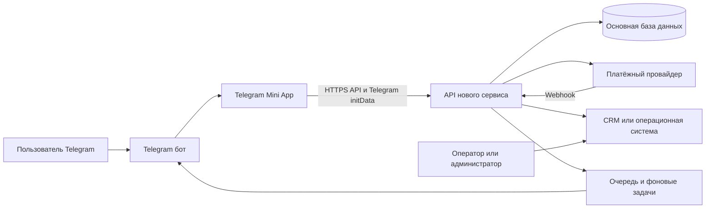
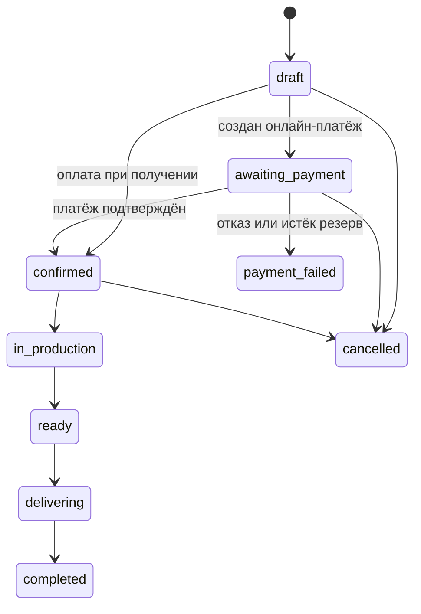

# Техническое задание на Telegram Mini App StimFood

**Версия:** 1.0  
**Статус:** базовое ТЗ для оценки, проектирования и разработки  
**Назначение документа:** зафиксировать существующую логику Telegram-бота и требования к переносу пользовательских сценариев в Telegram Mini App с новым серверным API и без Google Sheets.

## 1. Цель проекта

Текущий StimFood работает как чат-бот для заказа обедов правильного питания. Пользователь регистрируется в диалоге, просматривает меню, выбирает тариф, адрес, время и количество, после чего заказ сохраняется в Google Sheets и дополнительно отправляется в CRM.

Нужно перенести клиентский процесс в Telegram Mini App. Mini App должен получать меню, цены, остатки, профиль, заказы и подписки из нового сервиса через API. Google Sheets необходимо полностью исключить из рабочего контура. Telegram-бот сохраняется как точка входа в Mini App и канал уведомлений.

Главный результат переработки: единый серверный источник данных, предсказуемый процесс оформления заказа, подтверждённые статусы оплаты, защита от двойного заказа и корректная работа с остатками при одновременных запросах.

## 2. Границы документа

Документ описывает:

- текущее поведение бота;
- пользовательские и административные сценарии;
- требования к интерфейсу Telegram Mini App;
- требования к API нового сервиса;
- целевые сущности и статусы;
- правила обработки заказов, оплат, остатков и подписок;
- требования к миграции с Google Sheets;
- критерии приёмки;
- вопросы, которые нужно согласовать до разработки.

Документ не выбирает конкретный frontend- или backend-фреймворк и не заменяет дизайн-макеты, OpenAPI-спецификацию и схему базы данных. Эти артефакты должны быть подготовлены на следующем этапе на основе данного ТЗ.

## 3. Термины

| Термин | Значение |
|---|---|
| Mini App | Веб-приложение, открываемое внутри Telegram через Telegram Web Apps API |
| Бот | Telegram-бот StimFood, который открывает Mini App и отправляет служебные сообщения |
| Новый сервис | Серверная система StimFood, предоставляющая API и являющаяся источником данных |
| Тариф | Вариант комплектации обеда с собственной ценой |
| Позиция меню | Набор блюд на конкретную дату, доступный для заказа |
| Остаток | Количество доступных порций позиции меню |
| Умный заказ | Подписка на автоматическое оформление одного обеда в рабочий день |
| Разовый заказ | Заказ, который пользователь собирает и подтверждает вручную |
| Оператор | Сотрудник, который обрабатывает заказы, обращения и исключительные ситуации |

## 4. Текущее состояние системы

### 4.1 Архитектура

Текущая система состоит из:

- Telegram-бота на Python и Aiogram;
- Google Sheets как хранилища клиентов, меню, заказов, превышенного спроса, подписок и результатов опросов;
- SQLite для временных состояний диалога и связи Telegram-опросов с пользователями;
- внешней CRM, куда заказ отправляется отдельным HTTP-запросом;
- фоновых задач для утренней рассылки и автоматических заказов по подписке.

Основные листы Google Sheets:

| Лист | Назначение | Основные поля |
|---|---|---|
| Клиенты | Профили пользователей | telegram_id, имя, username, телефон, дата регистрации |
| Меню | Меню и остатки | день, блюда, количество, фото |
| Заказы | Оформленные заказы | дата, user_id, имя, телефон, блюдо, тариф, адрес, время, количество, оплата |
| Заказы свыше | Спрос на закончившиеся позиции | дата, пользователь, контакты, блюдо, адрес, время |
| Подписки | Умные заказы | дата, пользователь, тариф, адрес, время, дни, остаток дней, стоимость, оплата, статус |
| Опросы | Ответы пользователей | дата, chat_id, имя, username, вопрос, ответ |

### 4.2 Команды бота

Пользовательские команды:

- `/start` — регистрация нового пользователя или показ сегодняшнего меню зарегистрированному пользователю;
- `/menu` — показ сегодняшнего меню;
- `/support` — отправка сообщения оператору;
- `/info` — информация о доставке и оплате.

Административные команды:

- `/send_all` — массовая текстовая рассылка всем клиентам;
- `/poll` — создание и отправка всем клиентам неанонимного опроса с множественным выбором.

### 4.3 Регистрация пользователя

Текущая последовательность:

1. Пользователь отправляет `/start`.
2. Бот ищет клиента по Telegram ID.
3. Если клиент найден, бот сразу показывает меню.
4. Если клиент не найден, бот просит имя и фамилию.
5. Имя должно состоять из двух слов; допустимы русские и латинские буквы и дефис.
6. Бот просит номер телефона. Пользователь может ввести его текстом или отправить Telegram-контакт.
7. Телефон нормализуется до строки с `+`; минимальная проверка — не менее 10 цифр.
8. Профиль записывается в лист «Клиенты».
9. Пользователь получает подтверждение регистрации и меню на сегодня.

В текущей реализации нет отдельного согласия с политикой обработки персональных данных и нет интерфейса редактирования профиля.

### 4.4 Меню и тарифы

Бот загружает все позиции меню на текущую дату. Если позиций несколько, пользователь перелистывает их кнопками. Для позиции показываются описание, фото при наличии и текущий остаток.

Доступны четыре тарифа:

| Тариф | Состав | Текущая цена за порцию |
|---|---|---:|
| Максимум | горячее, суп, салат, напиток, фирменный соус | 16 BYN |
| Стандарт плюс | горячее, суп, салат | 14 BYN |
| Стандарт с супом | горячее и суп | 12 BYN |
| Стандарт с салатом | горячее и салат | 12 BYN |

Состав блюда хранится одним многострочным текстом. Бот считает первую строку супом, вторую горячим, третью салатом, четвёртую напитком. Такой формат зависит от порядка строк и должен быть заменён структурированными компонентами в новой системе.

Пользователь также может открыть меню на текущую неделю. Оно строится от понедельника до воскресенья и содержит дату, день недели и описание блюда.

### 4.5 Разовый заказ

Текущая последовательность:

1. Пользователь открывает сегодняшнее меню.
2. Выбирает позицию, если позиций несколько.
3. Выбирает тариф.
4. Бот проверяет, что остаток позиции больше нуля.
5. Если остаток равен нулю, бот сообщает, что блюдо закончилось, и записывает интерес пользователя в «Заказы свыше».
6. Пользователь выбирает адрес доставки из списка или вводит произвольный адрес.
7. Пользователь выбирает интервал доставки.
8. Пользователь выбирает количество: 1, 2, произвольное значение или акцию 5 плюс 1.
9. Бот показывает состав заказа и рассчитанную стоимость.
10. Пользователь выбирает оплату при получении либо переходит по ссылке онлайн-оплаты и затем нажимает «Я оплатил онлайн».
11. При подтверждении бот повторно проверяет остаток и уменьшает его.
12. Заказ записывается в Google Sheets.
13. Заказ отправляется в CRM.
14. Операторы получают Telegram-уведомление о новом заказе.
15. Пользователь получает сообщение «Заказ принят».

Текущие предустановленные адреса:

- Цельсий;
- Дубровская СТиМ;
- Катин Бор СТиМ;
- БОНШЕ;
- произвольный адрес пользователя.

Текущие интервалы доставки:

- 12:00–13:00;
- 13:00–14:00.

Произвольное количество ограничено интерфейсом значением до 999. Для специального выбора количества 6 действует акция: пользователь получает 6 порций, но оплачивает 5. Для других значений акция не применяется.

### 4.6 Оплата

Текущая система поддерживает два пользовательских варианта:

- оплата при получении;
- онлайн-оплата через внешнюю страницу ЕРИП.

Онлайн-оплата фактически подтверждается заявлением пользователя: после перехода по ссылке он нажимает кнопку «Я оплатил онлайн». Бот не получает подтверждение от платёжной системы и не сверяет сумму. В новой системе оплаченный статус разрешено устанавливать только после серверного подтверждения платёжного провайдера или ручного подтверждения оператором с журналом изменений.

### 4.7 Умный заказ

Умный заказ — подписка на автоматическое оформление одного обеда в будний день.

Пользователь выбирает:

1. тариф;
2. адрес;
3. время доставки;
4. длительность — 5, 10 или 20 дней;
5. способ оплаты.

Стоимость рассчитывается как цена тарифа, умноженная на количество дней. В коде предусмотрены скидки или бесплатные дни, но в текущей конфигурации скидки и бесплатные дни фактически не применяются.

После оформления подписка получает статус «активна». Пользователь может посмотреть активную подписку и до 10 последних записей истории. Самостоятельная пауза, пропуск дня, изменение, отмена и возврат не реализованы.

В рабочий день около 09:31 по московскому времени система:

1. получает все активные подписки;
2. для каждой подписки берёт первую позицию меню на текущий день;
3. проверяет наличие хотя бы одной порции;
4. собирает состав согласно тарифу;
5. создаёт заказ на одну порцию;
6. отправляет заказ в CRM;
7. уменьшает остаток позиции на одну порцию;
8. уменьшает остаток дней подписки;
9. при нулевом остатке дней переводит подписку в статус «завершена»;
10. уведомляет пользователя об оформленном заказе.

Если меню отсутствует, позиция не найдена или порции закончились, заказ не создаётся и день подписки не списывается. Выходные пропускаются. Производственный календарь и праздничные дни не учитываются.

### 4.8 Рассылки и опросы

Ежедневно около 09:30 по московскому времени бот проверяет меню на текущий день. Если меню есть, всем зарегистрированным клиентам отправляется сообщение с меню, акцией 5 плюс 1 и предложением Умного заказа.

Администратор может отправить произвольную массовую рассылку. Отдельно администратор может создать вопрос с 2–10 вариантами и отправить всем пользователям Telegram-опрос с множественным выбором. Ответы сохраняются с привязкой к пользователю.

### 4.9 Поддержка

Пользователь отправляет `/support` и пишет одно текстовое сообщение. Сообщение пересылается всем администраторам. Администратор нажимает «Ответить» и отправляет пользователю одно текстовое сообщение от имени поддержки. В текущей реализации нет статуса обращения, истории диалога, вложений и распределения между операторами.

### 4.10 Интеграция с CRM

При создании разового или автоматического заказа бот передаёт в CRM:

- Telegram user ID;
- имя;
- телефон;
- адрес;
- признак розничного заказа;
- комментарий, содержащий тариф, состав, количество, время и способ оплаты.

Ошибка CRM логируется, но не отменяет заказ, уже записанный в Google Sheets. Поэтому фактическим источником заказов сейчас является таблица, а CRM получает копию не гарантированно.

## 5. Ограничения и риски текущей реализации

Следующие свойства нельзя переносить в новую систему без изменений:

1. **Google Sheets как база данных.** Нет транзакций, строгой схемы, блокировок и надёжной конкурентной обработки.
2. **Неатомарный остаток.** Два пользователя могут одновременно увидеть один и тот же остаток и попытаться оформить заказ.
3. **Самостоятельное подтверждение оплаты.** Нажатие пользователем кнопки не доказывает факт оплаты.
4. **Состав блюда по порядку строк.** Ошибка в тексте меню меняет состав тарифа.
5. **Цена в клиентской логике.** Цены и акция частично зашиты в коде; это создаёт риск расхождений.
6. **Нет стабильного идентификатора заказа.** Пользователь не получает номер, по которому можно отследить обращение.
7. **Нет явной модели статусов.** Заказ считается принятым сразу после записи, без этапов оплаты, приготовления, доставки и завершения.
8. **Нет защиты от повторной отправки.** Повторный клик или сетевой повтор может создать дубль.
9. **Ограниченная подписка.** Нет даты начала, календаря, паузы, пропуска, изменения и отмены.
10. **CRM не гарантирована.** Сбой передачи не виден пользователю и не приводит к автоматическому повтору.
11. **Настройки зашиты в коде.** Адреса, интервалы, цены и ссылка оплаты должны управляться сервером.
12. **Минимальная валидация профиля.** Нет подтверждения телефона и управления персональными данными.

## 6. Целевая архитектура



Распределение ответственности:

| Компонент | Ответственность |
|---|---|
| Telegram-бот | Открытие Mini App, сервисные уведомления, deep links, резервный канал поддержки |
| Mini App | Пользовательский интерфейс, навигация, ввод данных, показ состояния операций |
| API нового сервиса | Авторизация, бизнес-правила, цены, остатки, заказы, оплаты, подписки, профиль |
| Основная база данных | Единый источник истины по всем бизнес-сущностям |
| Фоновые задачи | Рассылки, автозаказы, повторы интеграций, истечение резервов |
| Платёжный провайдер | Создание платежа и подтверждение результата через webhook |
| CRM или операционная система | Работа операторов, производство, доставка и статусы заказа |

Google Sheets не должен участвовать в чтении или записи данных после переключения на новую систему.

## 7. Роли и права

### 7.1 Пользователь

Может:

- войти через Telegram;
- создать или отредактировать профиль;
- просматривать меню и остатки;
- рассчитать и оформить заказ;
- оплатить заказ или выбрать оплату при получении;
- просматривать свои заказы и их статусы;
- оформить и просматривать подписку;
- обратиться в поддержку;
- получать уведомления.

### 7.2 Оператор

Может в интерфейсе нового сервиса:

- просматривать и обрабатывать заказы;
- менять операционные статусы в пределах разрешённого процесса;
- подтверждать исключительные ручные оплаты;
- видеть и обрабатывать обращения;
- повторно запускать неуспешную интеграцию;
- отменять заказ с указанием причины.

### 7.3 Администратор

Дополнительно может:

- управлять меню, компонентами и фото;
- управлять тарифами, ценами и акциями;
- управлять адресами и интервалами доставки;
- управлять лимитами и остатками;
- управлять подписками;
- создавать рассылки и опросы;
- просматривать журнал действий и интеграций;
- назначать роли.

## 8. Требования к авторизации и профилю

### 8.1 Вход

1. Бот открывает Mini App через кнопку меню или сообщение.
2. Mini App получает `initData` от Telegram.
3. Mini App передаёт `initData` серверу без изменения.
4. Сервер проверяет подпись, срок жизни и Telegram bot token согласно документации Telegram.
5. Сервер создаёт короткоживущую сессию или access token.
6. Непроверенные данные `initDataUnsafe` нельзя использовать для авторизации.

### 8.2 Профиль

Обязательные поля:

- Telegram user ID;
- имя;
- фамилия;
- телефон;
- дата регистрации;
- статус профиля.

Дополнительные поля:

- Telegram username;
- язык;
- сохранённые адреса;
- адрес по умолчанию;
- согласие с политикой обработки персональных данных и его дата;
- настройки уведомлений.

Телефон можно получить через Telegram или ввести вручную. Сервер должен нормализовать его в международный формат. Правило подтверждения телефона нужно согласовать до разработки.

## 9. Требования к меню

### 9.1 Экран сегодняшнего меню

Экран должен показывать:

- дату;
- одну или несколько позиций;
- фото;
- структурированный состав: суп, горячее, салат, напиток, дополнения;
- доступные тарифы и их состав;
- цену тарифа;
- доступный остаток или признак «заканчивается»;
- недоступность позиции;
- кнопку оформления;
- переход к недельному меню;
- статус активной подписки при её наличии.

### 9.2 Недельное меню

Пользователь выбирает день и видит позиции на дату. Возможность заказа на будущую дату включается только при наличии соответствующего бизнес-правила. В первом релизе допускается оставить недельное меню информационным, как в текущем боте.

### 9.3 Структура данных меню

Компоненты меню должны храниться отдельными полями или сущностями. Нельзя определять тип блюда по номеру строки. Для каждого компонента следует хранить как минимум:

- идентификатор;
- тип компонента;
- название;
- описание;
- признаки аллергенов при наличии;
- пищевую ценность при наличии;
- порядок отображения.

Доступность тарифа для позиции должна приходить с сервера. Mini App не должен самостоятельно собирать тариф из текста.

## 10. Требования к разовому заказу

### 10.1 Основной процесс

1. Пользователь выбирает дату и позицию меню.
2. Пользователь выбирает тариф.
3. Пользователь задаёт количество.
4. Пользователь выбирает сохранённый адрес, доступную точку доставки или вводит новый адрес.
5. Пользователь выбирает доступный для адреса интервал.
6. Mini App запрашивает у сервера расчёт заказа.
7. Сервер возвращает состав, цену, скидку, итог, доступность и время жизни расчёта.
8. Пользователь выбирает способ оплаты.
9. Пользователь подтверждает заказ.
10. Сервер атомарно проверяет и резервирует остаток, создаёт заказ и возвращает номер заказа.
11. Для онлайн-оплаты сервер создаёт платёж и возвращает ссылку или параметры Telegram-compatible оплаты.
12. После подтверждения оплаты сервер переводит заказ в подтверждённое состояние.
13. Для оплаты при получении заказ может быть подтверждён сразу согласно настройкам.
14. Пользователь видит экран результата и получает сообщение от бота.

### 10.2 Серверный расчёт

Mini App не должен хранить доверенные цены и рассчитывать итог самостоятельно. Расчёт сервера должен включать:

- базовую цену;
- количество;
- применённую акцию;
- скидку;
- стоимость доставки при наличии;
- итоговую сумму;
- валюту;
- срок действия расчёта;
- причину недоступности, если заказ оформить нельзя.

Акция 5 плюс 1 должна быть настройкой сервера. Для сохранения текущего поведения правило формулируется так: при количестве 6 оплачиваются 5 порций. Нужно отдельно согласовать, должна ли акция работать для 12, 18 и других кратных значений.

### 10.3 Остатки и конкурентные запросы

Создание заказа и уменьшение доступного остатка должны выполняться одной транзакцией. Сервер обязан:

- повторно проверить остаток при создании заказа;
- не допустить отрицательного остатка;
- вернуть понятную ошибку при недостатке порций;
- поддержать временный резерв для онлайн-оплаты;
- освободить резерв при истечении времени или неуспешной оплате;
- обеспечить идемпотентность создания заказа.

Клиент отправляет уникальный `Idempotency-Key`. Повтор с тем же ключом и тем же телом должен вернуть исходный заказ, а не создать новый.

### 10.4 Статусы заказа

Минимальная модель:



Рекомендуемые коды статусов:

- `draft` — заказ создан, но не подтверждён;
- `awaiting_payment` — ожидается онлайн-оплата;
- `payment_failed` — оплата не подтверждена;
- `confirmed` — заказ подтверждён;
- `in_production` — готовится;
- `ready` — готов к выдаче или доставке;
- `delivering` — передан в доставку;
- `completed` — завершён;
- `cancelled` — отменён.

Каждое изменение статуса должно сохраняться в истории с датой, источником и ответственным субъектом.

## 11. Требования к оплате

Поддерживаемые способы должны приходить с сервера и зависеть от заказа, адреса и настроек.

### 11.1 Оплата при получении

- Сервер сохраняет способ `cash_on_delivery` или согласованный эквивалент.
- Статус оплаты остаётся `unpaid` до подтверждения оператором или интеграцией.
- Статус заказа не должен называться «оплачен».

### 11.2 Онлайн-оплата

- Платёж создаётся на сервере с точной суммой и привязкой к заказу.
- Клиент не может передать доверенную сумму.
- Успех определяется webhook от провайдера или серверной проверкой статуса.
- Webhook должен проверяться по подписи и обрабатываться идемпотентно.
- Возврат, частичный возврат и отмена должны иметь отдельные статусы, если поддерживаются провайдером.
- Кнопка «Я оплатил» не должна устанавливать оплаченный статус.

Минимальные статусы платежа: `pending`, `paid`, `failed`, `cancelled`, `refunded`.

## 12. Требования к Умному заказу

### 12.1 Оформление

Пользователь выбирает тариф, адрес, время, длительность и способ оплаты. Сервер возвращает расчёт и дату начала. До подтверждения необходимо показать:

- тариф и состав;
- цену дня;
- число оплачиваемых и бонусных дней;
- итог;
- дату начала;
- расписание;
- правила пропуска и отмены;
- способ оплаты.

### 12.2 Автоматическое создание заказов

Для сохранения текущего поведения MVP должен:

- создавать один заказ на один обед по будням;
- использовать первую доступную позицию меню дня либо явно назначенную позицию дня;
- выполнять создание после публикации меню;
- не списывать день, если меню отсутствует, позиция недоступна или заказ не создан;
- уменьшать остаток дней только после успешного создания заказа;
- уведомлять пользователя о результате;
- переводить подписку в `completed`, когда дни закончились.

Новая реализация должна предотвращать повторное создание автозаказа для одной подписки и даты. Для этого нужна уникальность по паре `subscription_id + service_date`.

### 12.3 Статусы подписки

Минимальные статусы:

- `pending_payment`;
- `active`;
- `paused`;
- `completed`;
- `cancelled`.

Пауза, самостоятельный пропуск, перенос, отмена и возврат рекомендуются для следующего этапа, если они не войдут в MVP. Решение должно быть принято до реализации API, чтобы не менять модель данных после запуска.

### 12.4 Календарь

Расписание должно задаваться в часовом поясе бизнеса. Текущая зона — Europe/Moscow, UTC+3. Необходимо определить:

- учитываются ли государственные праздники;
- можно ли заказать в выходной;
- до какого времени пользователь может пропустить день;
- что происходит при отсутствии меню или остатка;
- переносится ли неиспользованный день на конец подписки.

## 13. Требования к экранам Mini App

Минимальный набор экранов:

1. **Загрузка и авторизация.** Проверка Telegram-сессии и состояния сервиса.
2. **Онбординг и профиль.** Имя, фамилия, телефон, согласия.
3. **Главная.** Сегодняшнее меню, активный заказ, активная подписка, быстрые действия.
4. **Карточка меню.** Фото, состав, тарифы, цены, остаток.
5. **Недельное меню.** Дни и позиции.
6. **Настройка заказа.** Тариф, количество, адрес, время.
7. **Проверка заказа.** Полный расчёт и способ оплаты.
8. **Оплата.** Переход к провайдеру и ожидание результата.
9. **Результат.** Номер заказа, статус, сумма, адрес и время.
10. **Мои заказы.** Текущие и завершённые заказы.
11. **Умный заказ.** Создание, активная подписка и история.
12. **Поддержка и информация.** Контакты, условия доставки и обращение.

Интерфейс должен поддерживать светлую и тёмную темы Telegram, безопасные отступы, системную кнопку Back и закрытие через Telegram Web Apps API.

## 14. Уведомления

Бот должен отправлять сообщения при событиях:

- заказ создан;
- требуется оплата;
- оплата подтверждена или не прошла;
- заказ подтверждён;
- статус заказа существенно изменён;
- заказ отменён;
- автозаказ подписки создан;
- автозаказ не создан и требуется действие пользователя;
- подписка скоро закончится;
- подписка завершена;
- оператор ответил на обращение.

Массовая утренняя рассылка, административная рассылка и опросы должны управляться новым сервисом. Список получателей нельзя брать из Google Sheets.

Повторная доставка уведомления не должна менять бизнес-состояние заказа. Ошибки отправки нужно сохранять и повторять по политике retry.

## 15. Поддержка

В MVP допускаются два варианта:

1. Mini App создаёт обращение в новом сервисе, а оператор отвечает через CRM или административный интерфейс.
2. Mini App открывает текущий диалог с ботом, но бот создаёт обращение через API.

Для обращения следует хранить идентификатор, пользователя, тему, текст, вложения при наличии, статус, ответственного, сообщения и даты. Минимальные статусы: `new`, `in_progress`, `resolved`, `closed`.

## 16. Требования к API

API должен быть версионирован, например `/api/v1`, использовать JSON и HTTPS. Ошибки должны иметь единый формат с машинным кодом, пользовательским сообщением и `request_id`.

### 16.1 Минимальные пользовательские методы

| Метод | Путь | Назначение |
|---|---|---|
| POST | `/auth/telegram` | Проверка initData и создание сессии |
| GET | `/me` | Получение профиля |
| PATCH | `/me` | Изменение профиля |
| GET | `/settings/order` | Адреса, интервалы, способы оплаты, ограничения |
| GET | `/menu?date=YYYY-MM-DD` | Меню на дату |
| GET | `/menu/week?from=YYYY-MM-DD` | Недельное меню |
| POST | `/orders/quote` | Серверный расчёт заказа |
| POST | `/orders` | Атомарное создание заказа |
| GET | `/orders` | Список заказов пользователя |
| GET | `/orders/{id}` | Заказ и история статусов |
| POST | `/orders/{id}/cancel` | Отмена, если разрешена |
| POST | `/orders/{id}/payments` | Создание онлайн-платежа |
| GET | `/payments/{id}` | Текущий статус платежа |
| POST | `/subscriptions/quote` | Расчёт подписки |
| POST | `/subscriptions` | Создание подписки |
| GET | `/subscriptions` | Активная подписка и история |
| GET | `/subscriptions/{id}` | Детали и журнал автозаказов |
| POST | `/support/requests` | Создание обращения |
| GET | `/support/requests` | История обращений пользователя |

### 16.2 Интеграционные методы

| Метод | Путь | Назначение |
|---|---|---|
| POST | `/webhooks/payments/{provider}` | Подтверждение статуса оплаты |
| POST | `/webhooks/order-status` | Приём статусов из операционной системы, если требуется |
| POST | `/internal/telegram/events` | Постановка уведомлений боту |
| GET | `/internal/orders/{id}` | Получение заказа для CRM или оператора |
| POST | `/internal/orders/{id}/sync` | Повтор синхронизации |

Точные пути могут отличаться, но перечисленные операции должны быть покрыты.

### 16.3 Пример запроса расчёта

```json
{
  "menu_item_id": "menu_2026_10_16_01",
  "tariff_id": "standard_plus",
  "quantity": 6,
  "delivery_location_id": "celsius",
  "delivery_address_text": null,
  "time_slot_id": "12_13",
  "service_date": "2026-10-16"
}
```

### 16.4 Пример ответа расчёта

```json
{
  "quote_id": "qt_01J...",
  "expires_at": "2026-10-16T09:45:00+03:00",
  "available": true,
  "currency": "BYN",
  "unit_price": 14,
  "quantity": 6,
  "billable_quantity": 5,
  "discount": 14,
  "delivery_price": 0,
  "total": 70,
  "promotion": {
    "code": "FIVE_PLUS_ONE",
    "title": "5 плюс 1"
  }
}
```

### 16.5 Пример ошибки

```json
{
  "error": {
    "code": "INSUFFICIENT_STOCK",
    "message": "Доступно только 2 порции",
    "request_id": "req_01J...",
    "details": {
      "available_quantity": 2
    }
  }
}
```

Обязательные коды ошибок: `UNAUTHORIZED`, `VALIDATION_ERROR`, `MENU_NOT_FOUND`, `ITEM_UNAVAILABLE`, `INSUFFICIENT_STOCK`, `QUOTE_EXPIRED`, `PAYMENT_REQUIRED`, `PAYMENT_FAILED`, `DUPLICATE_REQUEST`, `SUBSCRIPTION_CONFLICT`, `INTEGRATION_UNAVAILABLE`, `INTERNAL_ERROR`.

## 17. Целевая модель данных

### 17.1 User

- `id`;
- `telegram_user_id` с уникальным индексом;
- `first_name`, `last_name`, `username`;
- `phone`;
- `status`;
- `timezone`, `language`;
- `created_at`, `updated_at`;
- сведения о согласиях.

### 17.2 MenuDay и MenuItem

- дата обслуживания;
- статус публикации;
- время начала и окончания заказа;
- позиция меню;
- фото;
- структурированные компоненты;
- доступные тарифы;
- общий или отдельный по тарифам лимит;
- продано, зарезервировано, доступно.

### 17.3 Tariff

- стабильный код;
- отображаемое название;
- состав;
- цена;
- валюта;
- период действия;
- активность.

### 17.4 DeliveryLocation и TimeSlot

- название и тип точки;
- адрес или правила ввода адреса;
- допустимые интервалы;
- стоимость доставки;
- минимальный заказ;
- дни работы;
- время окончания приёма заказов;
- активность.

### 17.5 Order

- номер заказа;
- пользователь;
- дата обслуживания;
- снимок меню и тарифа на момент заказа;
- количество;
- цена, скидка, доставка, итог, валюта;
- адрес и интервал;
- способ и статус оплаты;
- статус заказа;
- источник: `manual` или `subscription`;
- идентификатор подписки при наличии;
- `idempotency_key`;
- даты создания и изменения;
- причина отмены.

Снимок названия, состава и цены обязателен: последующее изменение меню не должно менять уже созданный заказ.

### 17.6 Payment

- заказ;
- провайдер;
- внешний идентификатор;
- сумма и валюта;
- статус;
- ссылка на оплату;
- время истечения;
- данные подтверждения и возврата;
- журнал webhook-событий.

### 17.7 Subscription и SubscriptionExecution

Подписка хранит тариф, расписание, адрес, время, даты, приобретённые и оставшиеся дни, стоимость, способ оплаты и статус.

Каждый плановый день хранится отдельной записью выполнения со статусом `scheduled`, `order_created`, `skipped`, `failed` или `moved`, ссылкой на заказ и причиной результата.

### 17.8 AuditLog и IntegrationEvent

Критические изменения заказа, оплаты, подписки и остатка должны записываться в аудит. Отправку в CRM, Telegram и платёжные системы следует хранить как интеграционные события с числом попыток и последней ошибкой.

## 18. Нефункциональные требования

### 18.1 Безопасность

- Проверять Telegram `initData` на сервере.
- Использовать HTTPS для всех соединений.
- Не хранить секреты в репозитории и frontend-сборке.
- Разделить пользовательские, операторские и административные права.
- Ограничить частоту запросов авторизации, создания заказа, платежа и поддержки.
- Валидировать все данные на сервере.
- Не доверять цене, скидке, остатку и статусу из Mini App.
- Хранить персональные данные и журналы доступа согласно принятой политике.
- Проверять подписи webhook и защищаться от повторной обработки.

### 18.2 Надёжность

- Все операции изменения заказа и остатка должны быть транзакционными.
- Интеграции должны поддерживать повторные попытки с задержкой.
- Необработанные события должны попадать в очередь ошибок и быть видны оператору.
- Фоновые задачи должны иметь блокировку от параллельного запуска.
- Время должно храниться с часовым поясом; бизнес-правила выполняются в согласованной зоне.
- Резервное копирование базы и восстановление должны быть проверены до запуска.

### 18.3 Производительность

Целевые значения для MVP при штатной нагрузке:

- 95 процентов GET-запросов — до 500 мс без учёта загрузки изображений;
- 95 процентов команд расчёта и создания заказа — до 1,5 секунды без учёта платёжного провайдера;
- открытие первого содержательного экрана Mini App — до 3 секунд при обычном мобильном соединении;
- поддержка не менее 100 одновременных оформлений с корректными остатками.

Числа следует уточнить после оценки ожидаемой аудитории.

### 18.4 Наблюдаемость

- Структурированные логи с `request_id`, `user_id`, `order_id` и `integration_event_id`.
- Метрики ошибок API, времени ответа, созданных заказов, отказов по остаткам и платежам.
- Отдельные метрики автозаказов: запланировано, создано, пропущено, ошибка.
- Оповещение ответственных при длительной недоступности API, CRM, оплаты или Telegram.
- Доступный оператору журнал повторной синхронизации.

### 18.5 Совместимость и интерфейс

- Поддержать актуальные версии Telegram на iOS, Android и Desktop.
- Проверить поведение во встроенном браузере и при возврате из платёжного приложения.
- Поддержать светлую и тёмную тему.
- Не полагаться только на цвет для передачи статуса.
- Сохранять введённые данные при временном сетевом сбое.
- Не допускать повторного создания заказа при повторном нажатии кнопки.

## 19. Администрирование через новый сервис

Новый сервис должен предоставлять операторский или административный интерфейс либо эквивалентный API для следующих операций:

- публикация и снятие меню;
- загрузка изображений;
- создание компонентов меню;
- настройка тарифов и цен;
- настройка акций;
- управление остатками;
- настройка адресов, интервалов и времени окончания заказов;
- просмотр и фильтрация заказов;
- изменение статусов с аудитом;
- управление подписками;
- обработка обращений;
- массовые уведомления и опросы;
- просмотр ошибок интеграций;
- выгрузка отчётов.

Mini App не должен содержать административные экраны, если это отдельно не согласовано.

## 20. Миграция данных

### 20.1 Что переносить

Обязательный минимум:

- активные клиенты;
- актуальное и будущее меню;
- действующие тарифы, адреса и интервалы;
- активные подписки с оставшимися днями;
- незавершённые заказы, если они есть на момент переключения.

По отдельному решению:

- история заказов;
- завершённые подписки;
- ответы на опросы;
- записи превышенного спроса.

### 20.2 Правила миграции

- Перед импортом зафиксировать схему и очистить дубли клиентов по Telegram ID.
- Нормализовать телефоны и даты.
- Сопоставить текстовые тарифы со стабильными кодами.
- Разобрать меню на структурированные компоненты вручную или через контролируемый импорт.
- Сверить активные подписки и остаток дней с ответственным сотрудником.
- Сохранить таблицы только как архив после переключения, без записи из нового приложения.
- Зафиксировать количество импортированных, пропущенных и ошибочных записей.

### 20.3 План переключения

1. Утвердить спорные бизнес-правила из раздела 23.
2. Реализовать и протестировать API нового сервиса.
3. Импортировать тестовую копию данных.
4. Провести сверку меню, остатков, клиентов и подписок.
5. Подключить Mini App к тестовому окружению.
6. Провести приёмочные сценарии.
7. На короткое окно остановить изменение данных в Google Sheets.
8. Выполнить финальный импорт.
9. Переключить кнопку бота на Mini App и включить новый API.
10. Проверить первый реальный заказ и первую оплату под наблюдением.
11. Оставить возможность контролируемого отката на согласованный срок.
12. После стабилизации отключить рабочий доступ к таблицам.

## 21. Критерии приёмки MVP

1. Новый пользователь входит через Telegram, заполняет профиль и видит меню.
2. Повторный вход не создаёт дубликат пользователя.
3. Меню и цены загружаются только из нового API.
4. Компоненты тарифа приходят в структурированном виде.
5. Пользователь оформляет разовый заказ с выбранными тарифом, количеством, адресом и временем.
6. Итоговая стоимость совпадает с серверным расчётом.
7. Для количества 6 сервер применяет согласованное правило 5 плюс 1.
8. При недостатке остатка заказ не создаётся, остаток не становится отрицательным.
9. Два конкурентных заказа на последнюю порцию не могут оба завершиться успешно.
10. Повтор одного запроса с тем же ключом не создаёт дубль.
11. Оплата при получении сохраняется без ложного статуса «оплачено».
12. Онлайн-заказ становится оплаченным только после подтверждения провайдера.
13. Неоплаченный резерв освобождается после истечения срока.
14. Пользователь видит номер и актуальный статус заказа.
15. Бот отправляет подтверждение и значимые изменения статуса.
16. Пользователь оформляет подписку на 5, 10 или 20 дней.
17. Для одной подписки в одну дату создаётся не более одного автозаказа.
18. Неуспешный автозаказ не списывает день подписки.
19. После последнего успешного дня подписка завершается.
20. Оператор видит заказ и историю его изменений в новом сервисе.
21. Сбой CRM или Telegram фиксируется и допускает повтор без дублирования заказа.
22. Google Sheets не читается и не изменяется приложением.
23. Секреты отсутствуют во frontend-сборке, репозитории и пользовательских ответах API.
24. Основные сценарии работают в Telegram для iOS, Android и Desktop.

## 22. Рекомендуемое разделение релизов

### MVP

- авторизация Telegram;
- профиль;
- сегодняшнее и недельное меню;
- тарифы и остатки;
- разовый заказ;
- серверный расчёт и акция 5 плюс 1;
- оплата при получении и подтверждённая онлайн-оплата;
- статусы и история заказов;
- Умный заказ с текущей логикой;
- уведомления;
- поддержка;
- административная работа через новый сервис;
- миграция активных данных;
- полный отказ от Google Sheets.

### Следующий этап

- пауза и пропуск дня подписки;
- перенос адреса или времени для отдельного дня;
- отмены и возвраты из Mini App;
- повтор заказа;
- расширенная программа лояльности;
- персональные предложения;
- аллергены и КБЖУ;
- оценки заказов;
- аналитика конверсии;
- несколько способов доставки и зональная стоимость.

## 23. Вопросы на согласование

Эти решения влияют на модель данных, API и оценку разработки:

1. Новый сервис уже имеет готовый API или его нужно проектировать и разрабатывать вместе с Mini App?
2. CRM и новый сервис — одна система или две отдельные интеграции?
3. Можно ли заказывать только на сегодня или также на будущие даты?
4. Какое время окончания приёма заказа на текущий день?
5. Может ли на один день быть несколько позиций и как подписка выбирает между ними?
6. Остаток общий для позиции или отдельный для каждого тарифа?
7. Действует ли акция 5 плюс 1 только для количества 6 или для каждого набора из 6?
8. Актуальны ли цены 16, 14 и 12 BYN и кто может их менять?
9. Какие адреса и интервалы доступны фактически; зависит ли время от точки доставки?
10. Нужна ли доставка на произвольный адрес и как рассчитывается её стоимость?
11. Какая платёжная система будет использоваться и поддерживает ли она webhook, возвраты и тестовый контур?
12. Когда заказ с онлайн-оплатой резервирует остаток и сколько живёт резерв?
13. Можно ли отменить или изменить подтверждённый заказ и до какого времени?
14. С какой даты стартует подписка, оформленная после утреннего автозаказа?
15. Учитываются ли праздники, корпоративные выходные и переносы рабочих дней?
16. Может ли пользователь иметь несколько активных подписок?
17. Что делать, если по подписке закончились порции: переносить день, предложить замену или уведомлять оператора?
18. Нужны ли пауза, пропуск дня, изменение и отмена подписки в MVP?
19. Какие статусы заказа реально используются производством и доставкой?
20. Кто и в каком интерфейсе управляет меню, остатками, заказами, рассылками и поддержкой?
21. Какой объём истории нужно перенести из Google Sheets?
22. Требуется ли подтверждение телефона?
23. Какие юридические тексты и согласия должны быть показаны пользователю?
24. Нужны ли опросы и массовые рассылки в первом релизе Mini App?

## 24. Артефакты следующего этапа

После согласования вопросов должны быть подготовлены:

- кликабельный прототип экранов;
- карта переходов Mini App;
- OpenAPI 3.1 спецификация;
- схема базы данных;
- таблица ролей и прав;
- таблица событий и уведомлений;
- описание интеграции с оплатой;
- описание интеграции с CRM;
- сценарии миграции и отката;
- тест-план с позитивными, негативными и конкурентными сценариями;
- план мониторинга и поддержки запуска.

## 25. Источник требований

Описание текущего поведения подготовлено по коду проекта StimFood, включая модульное приложение в каталоге `app`, точку запуска `main.py` и сохранённый перечень примеров Mini App. Если рабочее поведение на сервере отличается от этой версии кода, перед оценкой разработки нужно сверить продакшн-конфигурацию и бизнес-процесс с оператором.

